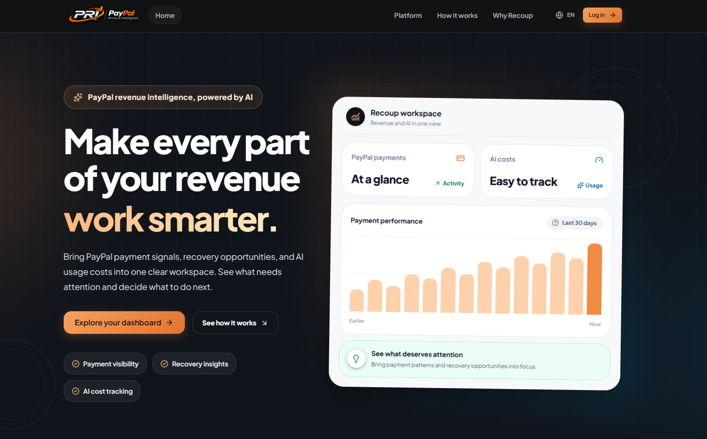
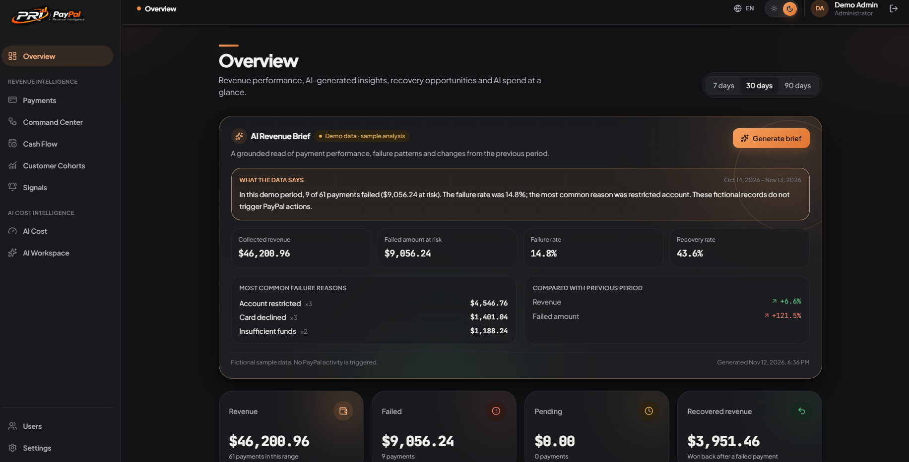
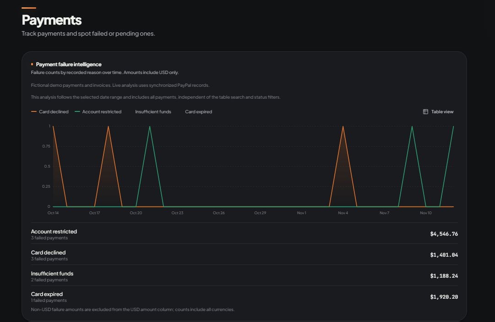
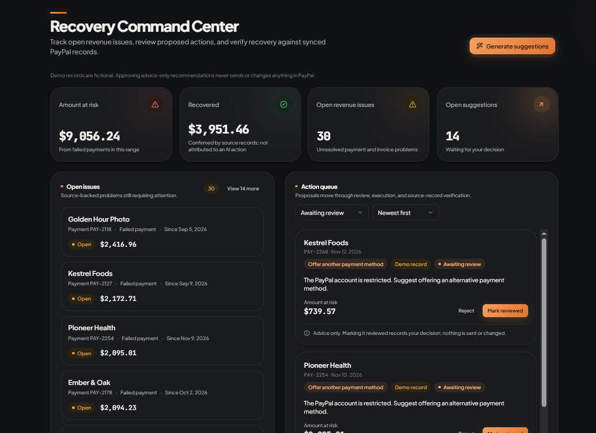
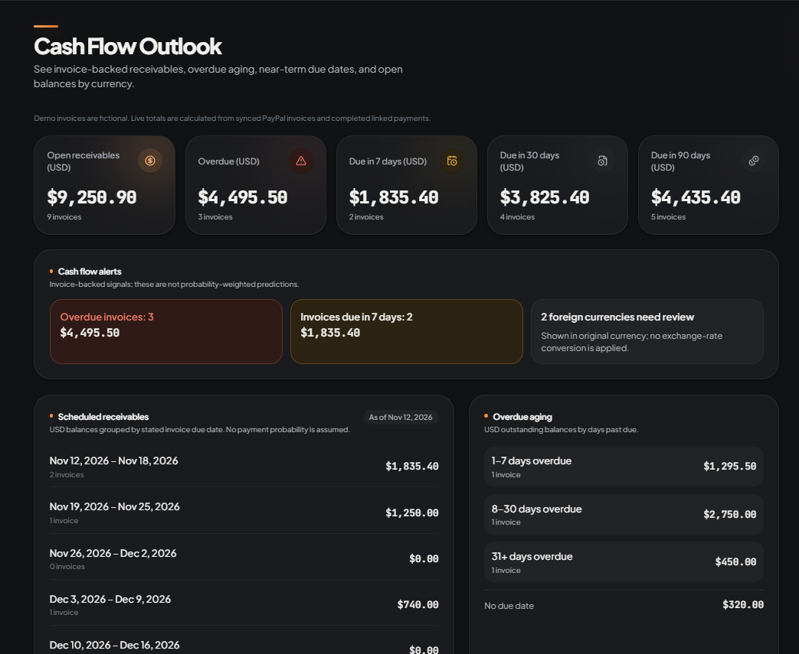
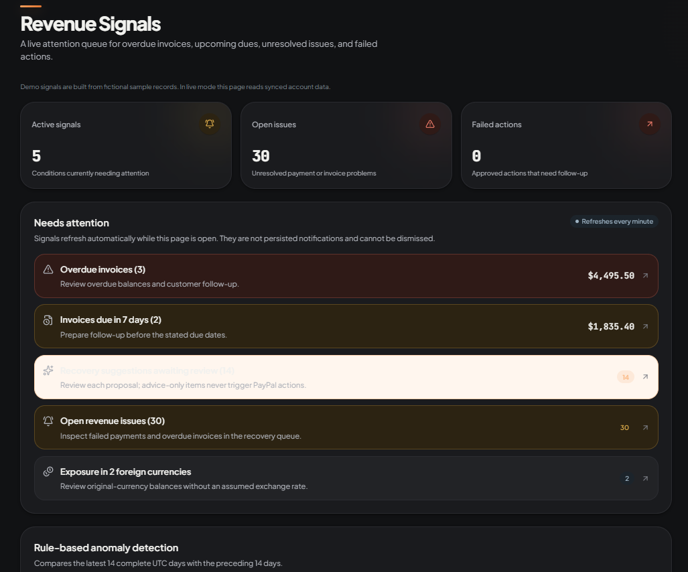
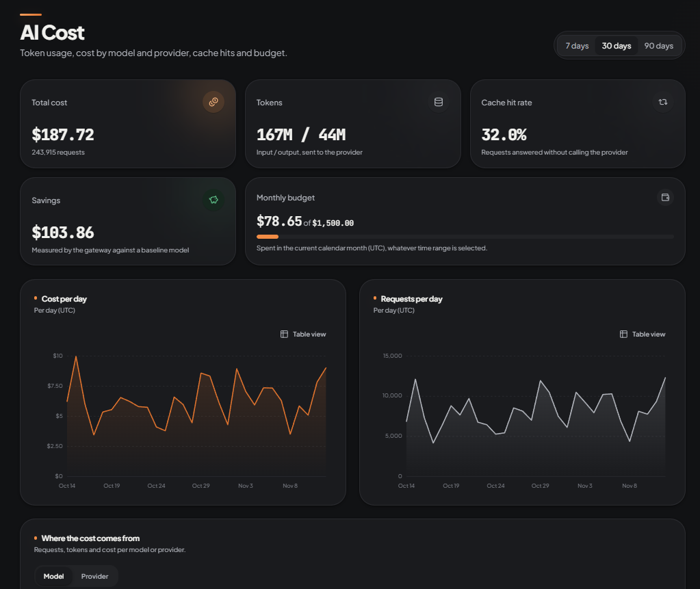
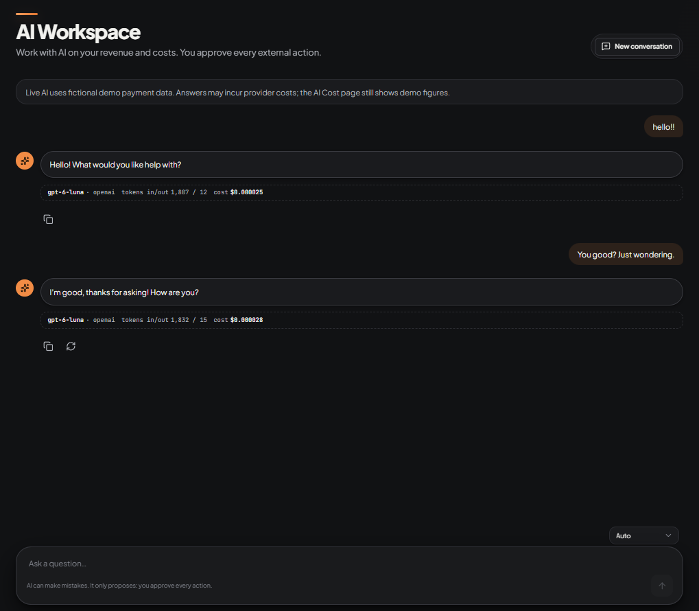
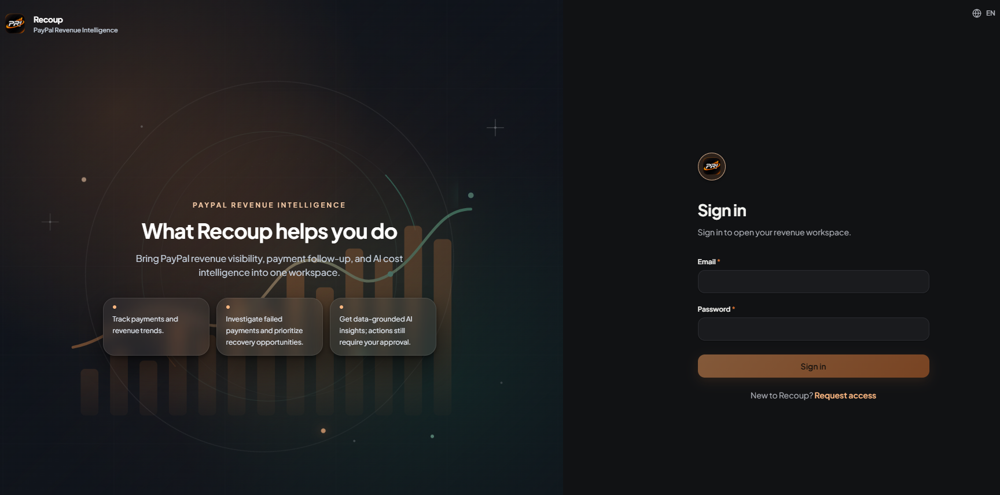
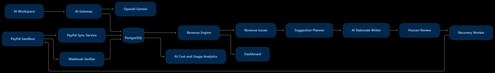

# Recoup — PayPal Revenue Intelligence

**See where revenue is exposed. Understand what AI costs. Decide what to do next.**

Recoup is a revenue-operations and AI-cost intelligence workspace built around PayPal payment data. It brings payment outcomes, invoice balances, recovery work, revenue analysis, and AI workload economics into one operational view.

Rather than treating payment reporting and AI spend as unrelated dashboards, Recoup puts them side by side: finance and operations teams can investigate revenue exposure while product and engineering teams understand the cost of the AI systems they run. The product emphasizes traceable source data, transparent calculations, and human approval before customer-facing recovery actions.

> **Project status:** Hackathon-stage implementation. PayPal connectivity is Sandbox-only. The frontend includes a fictional-data demo adapter, while the backend provides the implemented API, persistence, PayPal Sandbox integration, and AI gateway. Read [Current limitations](#current-limitations) before interpreting demo or provider-derived figures.

## The story in one minute

A business can see that a payment failed. What it often cannot see in one place is the full picture: whether the customer still has an open invoice, how much cash is outstanding, whether the same failure is recurring, what follow-up is appropriate, and what its AI tooling is costing at the same time.

**Recoup turns that fragmented picture into a reviewable operational workflow.** It connects PayPal payment and invoice records with revenue analytics, recovery work, cash-flow visibility, and AI usage economics. Instead of presenting another transaction list, it helps a team move from a signal to an evidence-backed decision:

- **See the exposure:** distinguish completed, failed, pending, and refunded payments from outstanding invoice balances.
- **Understand the cause:** inspect transaction history, failure patterns, customer cohorts, and overdue aging.
- **Choose the next action:** surface issues and generate bounded recovery proposals with an explanation.
- **Keep a person in control:** require review and approval before an eligible customer-facing PayPal invoice reminder is sent.
- **Measure the other side of the operation:** track AI provider/model usage, estimated cost, caching, and budget in the same workspace.

Recoup is positioned as a product for making financial operations more explainable and AI-assisted workflows more accountable. The supplied materials do not include verified team member names, biographies, or individual role assignments, so this README describes the product and its engineering decisions rather than inventing a team backstory.

## The problem

Businesses often have enough payment data to see that something went wrong, but not enough connected context to decide what to do next.

- **Fragmented revenue visibility.** Payment attempts, invoice balances, refunds, and customer history can live in separate screens or systems. A single headline revenue number can hide failed, pending, refunded, or still-outstanding amounts.
- **Failed payments and missed recovery opportunities.** Failure codes, invoice status, and follow-up actions are difficult to triage when they are not connected to a consistent workflow. A failed attempt is exposure to investigate—not automatically lost revenue.
- **Limited actionable payment intelligence.** A list of transactions does not explain patterns, identify overdue invoices, or distinguish a source-record issue from a proposed recovery action.
- **Unclear AI operating costs.** Teams adopting AI may have limited visibility into model choice, token usage, caching, provider mix, and the cost implications of different workloads.
- **Disconnected financial and AI operations.** Finance may monitor payment performance while engineering monitors AI usage elsewhere. This separation makes it harder to evaluate operational trade-offs across the business.

These gaps matter because delayed investigation can make recovery harder, unclear cash-flow exposure complicates planning, and unmeasured AI usage can make an otherwise useful feature expensive to operate.

## Why Recoup was built

Recoup was built around a practical observation: revenue operations and AI operations both need trustworthy measurement before they can be optimized.

Payment intelligence answers questions such as *what is outstanding, what failed, and what deserves attention?* AI cost intelligence answers *which provider and model handled a request, how much usage it consumed, and how much it cost?* Both require consistent records, explicit calculations, and enough context for a person to make a decision.

Putting these capabilities in one workspace gives teams a shared operational picture without pretending that payment recovery and model optimization are the same problem.

## Our approach

Recoup follows a human-reviewed operating loop:

1. **Observe** — Review revenue summaries, payment outcomes, invoice exposure, recovery status, and AI usage.
2. **Investigate** — Open individual payment records, inspect status history and failure reasons, and drill into cost or provider breakdowns.
3. **Prioritize** — Use issue ordering, rule-based signals, and AI-assisted rationale to identify work that may deserve attention.
4. **Review and approve** — Inspect proposed recovery actions. A person decides whether to approve or reject an action; eligible invoice reminders are not sent merely because a suggestion was generated.
5. **Optimize** — Learn from refreshed payment records and AI usage data, then adjust operational follow-up, model routing, budgets, or cache settings.

The product is designed around explainability and bounded automation. Financial metrics are calculated by backend code from stored records. AI can write commentary or rationale, but it does not invent the underlying financial facts. Provider calls and customer-facing actions remain subject to configuration, eligibility checks, and explicit user decisions.

## Key features

The application navigation and backend support the following product areas. Where the presentation frontend uses fictional data, that distinction is called out below.

### Revenue Overview & AI Revenue Brief

The Overview page presents a time-bounded view (7, 30, or 90 days) of revenue activity, payment status, failed and pending amounts, recovered revenue, and period-over-period deltas. In the real data path, the backend supplies the summary and the frontend formats it for display.

Hosted directly at the top of the workspace, the **AI Revenue Brief** combines server-calculated metrics with a short commentary. The backend refreshes revenue issues, calculates current and previous-period facts (such as failure rates, recovery rates, and top failure reasons like *Account restricted*, *Card declined*, or *Insufficient funds*), stores a metrics snapshot, and asks the configured rationale writer for commentary. If AI commentary cannot be produced, the application falls back to a deterministic rule/template-based summary.

**Why it is useful:** It gives operators an immediate starting point for spotting movement and turns verified figures into a readable operational summary while keeping the numbers strictly separate from generated prose.

### Payment Failure Intelligence & Investigation

The Payments page supports paginated, searchable, filterable payment records alongside a **Payment Failure Intelligence** time-series chart. It plots failure counts by recorded reason over time (*Card declined*, *Account restricted*, *Insufficient funds*, *Card expired*) and breaks down failed payment counts alongside USD-aggregated exposure. Details include payment status and available event/history information, as well as failure details where present.

**Why it is useful:** Teams can move from a dashboard-level spike to specific failure categories and inspect underlying transaction evidence before taking action.

### Recovery Command Center

The Recovery Command Center brings revenue issues and proposed recovery actions together into a split-view triage workflow:
- **Open Issues (Left Queue):** Lists source-backed problems still requiring attention (e.g., specific failed payment IDs, customer names, age of issue, and amount at risk).
- **Action Queue (Right Queue):** Displays AI-assisted recovery proposals filtered by review status (*Awaiting review*) and sorted chronologically. Each card details the suggested action (such as *Offer another payment method*), the rationale, the amount at risk, and explicit **Reject** or **Mark reviewed** controls.

Suggestion generation is bounded to at most ten candidates per run and prioritizes higher-amount issues before older ones. Advice-only proposals can be marked reviewed without altering PayPal state. Only executable, eligible PayPal invoice reminder actions enter the execution queue after explicit human approval, and the worker rechecks current source records before attempting an action.

**Why it is useful:** It separates *what needs attention* from *what someone has approved*, reducing the risk of accidental customer contact or overstated recovery.

### Cash Flow Outlook

The Cash Flow Outlook is invoice-backed and built for near-term liquidity visibility. It tracks **Open receivables**, **Overdue balances**, and amounts **Due in 7, 30, and 90 days**, alongside invoice-backed cash flow alerts.

It calculates **Overdue aging** buckets (`1–7 days`, `8–30 days`, `31+ days overdue`, and `No due date`) and groups due balances into a **13-week scheduled receivables** timeline (90 days). USD values are aggregated for the main forecast without assuming payment probabilities; foreign-currency balances remain grouped and flagged separately in their original currencies rather than being converted using an assumed exchange rate.

**Why it is useful:** It provides a grounded view of expected receivables and overdue exposure based on actual invoice balances, not a speculative forecast of future sales.

### Revenue Signals

Revenue Signals is a live, auto-refreshing attention queue (polling every minute while open) built from current operational records. It surfaces prioritized operational triggers—including overdue invoices, invoices due within 7 days, recovery suggestions awaiting review, open revenue issues, foreign-currency exposure, and **rule-based anomaly detection** (comparing the latest 14 complete UTC days against the preceding 14 days)—and links directly to the relevant operational pages.

**Why it is useful:** It helps operators immediately decide what to inspect next without acting as a noisy, unpersisted notification service.

### Customer Cohorts & Payment Outcome Breakdown

- **Customer Cohorts:** Groups customers by the month of their first successful USD payment and shows subsequent successful payment activity and revenue per cohort customer. The calculation uses payment history and does not infer subscription cancellations or churn.
- **Payment Outcome Breakdown:** Separates completed, failed, pending, and refunded payment activity in USD so teams can understand payment composition without conflating attempts, successful receipts, and refunds.

### AI Cost Intelligence

The AI Cost page reports recorded token usage and estimated spend across selectable windows (7, 30, or 90 days). It tracks **Total cost**, **Input / Output tokens**, **Cache hit rate** (requests answered via semantic cache without calling the provider), **Gateway savings** measured against a baseline model, and **Monthly budget** utilization. Interactive time-series charts display **Cost per day** and **Requests per day** (with toggleable table views), followed by granular breakdowns by **Model** and **Provider**.

**Why it is useful:** Teams can see exactly which models and workloads contribute to AI spend, measure cache efficiency, and enforce spending guardrails in the same platform where they monitor revenue.

### AI Workspace

AI Workspace provides a conversational interface backed by the backend AI gateway when `VITE_AI_SOURCE=real`. Requests can use **Auto** routing or be constrained to a specific provider (OpenAI or Gemini). Every assistant response displays transparent telemetry directly beneath the message—showing the exact model used (e.g., `gpt-6-luna`), provider, input/output token counts, and estimated request cost—alongside persistent guardrails reminding operators that the AI only proposes and humans approve every external action.

For payment-specific questions, the real adapter retrieves matching payment records and attaches that context to the request. With `VITE_AI_SOURCE=mock`, the workspace uses predefined local assistant responses for offline demonstrations.

**Why it is useful:** Users can explore operational questions in natural language with full cost and model transparency while ensuring the assistant remains strictly advisory.

### Authentication, PayPal Connection & Administration

- **Controlled Workspace Access:** Features a split-screen authentication portal backed by JWT bearer authentication, public registration with per-IP rate limiting (requiring administrator activation before login), and role-based user management (`admin` and `member` roles).
- **PayPal Connection Management:** Administrators can store PayPal Sandbox credentials (encrypted at rest using ASP.NET Core Data Protection), test the connection, inspect sync status, and trigger manual transaction/invoice synchronization. The integration also supports optional webhook notifications with signature verification and idempotent event handling.

## How Recoup works

A typical journey is:

1. An administrator configures PayPal Sandbox credentials and tests the connection.
2. A manual sync imports available transaction and invoice records into PostgreSQL. Optional signed webhook events can update supported payment statuses.
3. Backend query services and domain calculations derive revenue summaries, payment analytics, invoice balances, cohorts, and revenue issues.
4. The UI presents an overview and links users to the relevant payment, invoice, or recovery record.
5. The suggestion service plans possible recovery actions from issue and invoice facts. AI writes the rationale; it does not decide the action type or amount.
6. A user reviews and approves or rejects the suggestion. Only approved executable actions are queued.
7. Separately, AI Workspace requests pass through the AI gateway, which classifies the task, routes to an eligible configured model, checks budget/cache behavior, and records usage and cost.
8. Subsequent synchronization provides updated source records for operational confirmation.

## AI capabilities

Recoup's AI functionality is implemented as a backend gateway, not as direct browser-to-provider calls.

### Providers and configuration

- **OpenAI** — Chat completions and embeddings are implemented using the OpenAI API. The embedding provider supports semantic cache lookup.
- **Google Gemini** — Chat completion support is implemented through the Gemini API.
- Provider keys are read by the backend from configuration. They are not intended to be sent to the frontend.

### Task classification and model routing

The gateway classifies common request types such as default, classification, summarization, and analysis. Routing rules define a primary model and fallback models. In Auto mode, the router ranks eligible candidates using task fit and catalog token prices, including enabled provider candidates. A provider-specific selection constrains candidates to that provider. A configured primary is not guaranteed to run first if another eligible candidate ranks better.

The initial catalog and default rules are seeded by the backend. The catalog includes configured OpenAI model entries and a Gemini model entry; the actual model IDs and token prices are application configuration/data, not claims about a provider's general product catalog. Confirm current provider model availability and pricing before deployment.

### Token usage and cost tracking

The gateway records provider/model, input and output token counts, and calculated cost using the model catalog's stored USD per-million-token prices. Embedding cost uses the configured OpenAI embedding price. These are application-side estimates based on catalog values, not a replacement for provider invoices.

### Response caching

The gateway supports semantic response caching. It can create embeddings, search prior cache entries using a similarity threshold, and return a cache hit when a suitable entry exists. Cache configuration includes enablement, similarity threshold, TTL, candidate limit, and maximum query length. The cache can be inspected and cleared through administrative settings/API operations. Embedding/cache failures are designed to degrade to a non-cache path where appropriate.

### AI Revenue Brief and recovery assistance

The AI Revenue Brief passes server-calculated facts to the rationale writer. The commentary is validated and stored with its source metadata; a deterministic template fallback is available. Recovery suggestion types and executability are selected by rule-based planning from issue/invoice facts. AI contributes the human-readable rationale only.

### Conversational AI Workspace

The workspace sends conversation messages to the gateway completion endpoint. The gateway returns a response with provider/model and token/cost/cache metadata. The real frontend adapter adds matching payment context for payment-intent questions and instructs the model not to invent records, claim actions, or describe failed payment amounts as confirmed losses.

### Rule-based fallback and budget enforcement

Rule-based calculations remain the source of truth for revenue, payment, invoice, and recovery eligibility decisions. If generated commentary is unavailable, template/rule-based rationale is used. The AI gateway enforces a configured spending budget: requests are rejected when the applicable budget has been reached. The budget is a spending cap, not a signal used to rank models.

## PayPal integration

PayPal is the primary revenue data source for Recoup's payment-intelligence workflows. It supplies the transaction and invoice records from which payment outcomes, failure patterns, open receivables, and recovery candidates are derived.

### Developer Platform and Sandbox

The integration uses PayPal's REST APIs and OAuth 2.0 client-credentials access tokens. This version intentionally hard-codes the PayPal Sandbox API base URL and rejects non-Sandbox environment configuration. It is not a live-money integration.

### Transaction and invoice synchronization

Manual synchronization imports PayPal transaction-search results and available invoices, upserting records into the local database. Transaction search is split into windows no longer than 31 days, with pagination safeguards. Refunds are applied to relevant payment records. Unsupported or unrecognized source records are skipped and counted rather than fabricated.

Invoice access depends on the permissions enabled for the PayPal Sandbox app/account. If invoice access is unavailable, invoice import is marked as skipped; transaction synchronization may still complete. This affects invoice-backed Cash Flow Outlook and invoice reminder recovery.

### Webhooks

The optional webhook endpoint validates PayPal's transmission headers and signature against the configured webhook ID, then stores processed event IDs to make repeated deliveries idempotent. Supported capture events can update an already-synchronized payment's status. A webhook does not create a new payment record on its own; events for unknown payments are recorded as not yet synchronized and require a later sync. Invoice events and unsupported event types are recorded/ignored for immediate state changes and rely on later synchronization.

### Invoice reminders and recovery

For an eligible invoice reminder, the recovery worker calls PayPal's invoice reminder API after an administrator/user approval has been recorded. The worker rechecks the current invoice state before execution. Advice-only suggestions do not trigger PayPal calls. Recovery status should be confirmed from refreshed PayPal records rather than inferred from the fact that a reminder request was accepted.

## Target audience and use cases

| Audience | Practical use case |
|---|---|
| SaaS companies | Review failed payment attempts and invoice balances; investigate repeat failure reasons and overdue receivables. |
| E-commerce businesses | Monitor PayPal transaction outcomes, refunds, and failure patterns across a selected period. |
| Subscription-based businesses | Review recurring payment activity and customer cohorts. Recoup does not currently infer subscription cancellation or churn. |
| Digital service providers | Track invoice-backed receivables and review which outstanding invoices may qualify for a reminder. |
| Finance and revenue operations | Use revenue summaries, payment investigation, cash-flow aging, and the recovery queue to prioritize follow-up. |
| Product and engineering teams | Inspect AI provider/model usage, token consumption, estimated cost, cache performance, and monthly budget. |
| Small and medium-sized businesses | Bring payment visibility and AI spend monitoring into one operational workspace without requiring a separate analytics stack. |

## Business value and expected impact

Recoup is intended to help teams:

- **Identify revenue exposure** by separating completed, failed, pending, refunded, and open-invoice amounts.
- **Investigate payment failures** using transaction detail, status history, and failure-code trends.
- **Prioritize recovery work** with issue queues and rule-based suggestions that include AI-written rationale.
- **Understand cash flow** through invoice-backed balances, overdue aging, and a due-date schedule.
- **Evaluate AI spending** through provider/model breakdowns, usage records, cost estimates, cache statistics, and budget controls.
- **Make better-informed decisions** by keeping calculations traceable and requiring review for customer-facing recovery actions.

The project does not claim a guaranteed recovery rate, fixed savings, or a measured ROI. Any business impact must be evaluated using a company's own PayPal records and provider billing data.

## Product walkthrough for hackathon judges

A focused demonstration can follow this sequence:

1. **Overview:** choose a date range and inspect revenue, payment outcomes, daily trends, and the AI Revenue Brief.
2. **Payments:** filter the payment list, open a failed transaction, and inspect its failure details and history.
3. **Recovery Command Center:** show open issues separately from suggestions; generate proposals, review one, and explain why approval is required before an eligible reminder is sent.
4. **Cash Flow Outlook:** inspect overdue aging, partially paid invoices, the 13-week due schedule, and separately grouped foreign-currency exposure.
5. **Payment intelligence:** compare failure trends and reasons, then open Customer Cohorts and Revenue Signals.
6. **AI Cost:** compare provider/model usage, daily estimated cost, cache statistics, and budget status.
7. **AI Workspace:** ask an operational question and show the model/provider and usage metadata.
8. **Settings and administration:** show language/theme, PayPal Sandbox connection management, and account administration.

For a presentation without backend credentials, use the frontend demo mode. Clearly label its records as fictional and avoid implying that demo interactions contact PayPal.

## API contract and operational guarantees

The backend API contract is the source of truth for frontend/backend behavior. Its current documented version is **0.9 (2026-11-12)**. A concise summary of the guarantees that matter to users and evaluators:

- **Account access is controlled:** public registration creates a pending `member` account; an administrator must activate it before login. Administrators can also create active `admin` or `member` accounts directly. Passwords must be at least 12 characters, and public registration is limited to five attempts per IP in 15 minutes.
- **Financial calculations stay deterministic:** revenue totals, ratios, cohorts, cash-flow balances, and anomaly thresholds are calculated by backend code. AI writes explanations; it does not calculate or invent the financial facts.
- **Currency treatment is explicit:** core revenue analytics and cash-flow aggregates are USD-only. Open invoice balances in other currencies are shown separately in their original currencies; the application does not silently convert them using an assumed FX rate.
- **Time handling is consistent:** API timestamps use UTC ISO-8601 values ending in `Z`; analytics date ranges include `from` and exclude `to`.
- **Demo data is distinguishable:** records sourced from PayPal are marked `dataSource: "paypal"`; fictional records are marked `dataSource: "demo"` and should be presented as such.
- **The API distinguishes implemented and planned work:** only endpoints listed as **Ready** in the API contract are live contracts. Planned endpoint schemas are not evidence of a working live integration.

These constraints are part of the product design: they prevent a failed attempt from being mislabeled as confirmed lost revenue, an AI explanation from being mistaken for a financial calculation, or a proposed recovery action from being presented as an executed one.

## Technology stack

The repository contains the following technologies and packages:

| Area | Implementation |
|---|---|
| Frontend | React 19, TypeScript, Vite 8, React Router 8 |
| UI and styling | Tailwind CSS 4, `@tailwindcss/vite`, Lucide React, class-variance-authority, clsx, tailwind-merge |
| Client data | TanStack Query 5 |
| Backend | ASP.NET Core / .NET 8 Web API |
| Backend validation | FluentValidation 11 |
| Persistence | Entity Framework Core 8, Npgsql EF Core provider 8 |
| Database | PostgreSQL 17 with the `pgvector/pgvector:pg17` image in local Compose |
| Authentication | ASP.NET Core JWT bearer authentication, ASP.NET Core Data Protection, Identity password hashing |
| AI providers | OpenAI API (chat and embeddings), Google Gemini API |
| Payment provider | PayPal REST API, OAuth 2.0 client-credentials flow, PayPal webhook signature verification |
| API documentation | Swashbuckle / Swagger UI in Development |
| Local infrastructure | Docker Compose; multi-stage .NET Dockerfile |
| Testing | xUnit-based unit and API integration test projects |
| Frontend tooling | npm, TypeScript compiler, Vite, custom i18n validation script |

No separate frontend server framework or message broker is present in the repository. The recovery queue is implemented as an in-process background queue/worker.

## Architecture and engineering decisions

### Frontend/backend separation

The frontend talks to a shared API abstraction. `VITE_DATA_SOURCE` selects the mock or real business-data adapter; `VITE_AI_SOURCE` independently selects the mock or real AI workspace adapter. The HTTP client centralizes the API base URL, locale header, timeout handling, response parsing, and API error mapping.

### Application, domain, and infrastructure layers

The .NET solution is split into:

- `PRI.Domain` — business entities, enums, invariants, and domain interfaces.
- `PRI.Application` — use cases, DTOs, validators, calculation services, and application interfaces.
- `PRI.Infrastructure` — EF Core persistence, repositories, provider clients, credential storage, and provider integrations.
- `PRI.Api` — controllers, authentication, middleware, background worker registration, and HTTP configuration.
- `PRI.Shared` — shared constants, errors, and cross-layer types.

The API composition root wires these layers through dependency injection.

### Data adapters and calculation ownership

The frontend adapter boundary allows the fictional presentation dataset to be used independently of the backend. In real mode, implemented API operations are mapped to backend endpoints. Revenue analytics, invoice balances, cohort metrics, issue generation, and cost calculations are owned by backend services and persisted/query-backed records. The frontend formats and presents these results rather than re-deriving business totals.

### AI gateway

Provider integrations implement shared application interfaces and are resolved by the gateway. The model catalog and routing rules are stored in PostgreSQL and seeded when database initialization is enabled. The gateway applies task classification, model ranking, provider fallback, budget checks, usage recording, and caching around provider calls.

### Data synchronization

PayPal synchronization is an explicit use case. It records sync runs, uses bounded transaction-search windows and pagination, upserts supported records, tracks skipped records, and captures invoice-import limitations. Webhook processing verifies signatures, deduplicates event IDs, and updates only known payment records for supported event types.

### Security and credentials

The backend validates JWTs and checks that the user is still active. Administrator-only endpoints protect PayPal credential management, sync, and user administration. Saved PayPal credentials are encrypted with ASP.NET Core Data Protection and written to a protected file; Data Protection keys must persist across restarts for the file to remain decryptable. Provider API keys should be supplied through .NET User Secrets or environment variables, never committed configuration files.

### Error handling and fallbacks

The API uses a global exception handler and Problem Details responses with trace identifiers. The frontend HTTP client normalizes API, network, timeout, and unauthorized errors. AI provider candidates can fall back according to routing rules; revenue insight commentary and recovery rationale have deterministic fallbacks. These fallbacks do not make external provider functionality available when credentials are missing.

## Engineering strategies

- **Financial facts are calculated outside the LLM.** AI is used for commentary and rationale, not to decide financial totals or recovery eligibility.
- **Recovery actions are approval-gated.** Suggestions are persisted separately from decisions and execution; eligible work is queued only after approval.
- **Source records are rechecked before execution.** The recovery worker verifies the current invoice/payment context before calling PayPal.
- **Sync is bounded and observable.** Transaction windows, pagination limits, sync-run records, and skipped-record counters make import behavior easier to inspect.
- **Webhook delivery is idempotent.** Processed event IDs are persisted so duplicate deliveries are not applied twice.
- **AI cost is recorded at the gateway.** Token counts and catalog prices are stored with usage records, and budget enforcement occurs before additional provider spend.
- **Caching is optional and resilient.** Semantic caching is configurable; failures in cache/embedding work can fall back to the provider path.
- **Tests cover domain and gateway behavior.** The repository includes separate revenue, AI gateway, and API integration test projects.

## Current limitations

- **PayPal Sandbox only:** the implementation rejects any PayPal environment other than `sandbox`; live-money processing is not supported.
- **Sandbox permissions vary:** invoice import and invoice reminder functionality depend on the Sandbox app/account's Invoicing permissions. Transaction synchronization can continue when invoice import is skipped.
- **Fictional demo records:** frontend mock data is illustrative, not connected to PayPal, and must not be treated as verified business data. Backend demo seeding is separately controlled and disabled by default in the supplied development settings.
- **AI requires provider configuration:** real AI requests require a valid OpenAI and/or Gemini key. Provider availability, model IDs, and pricing can change.
- **AI Workspace adapter selection:** mock AI responses are available for offline demos. Real AI calls go through the backend and may incur provider charges.
- **Currency aggregation:** primary revenue analytics and cash-flow totals are USD-focused. Non-USD invoice balances are exposed separately; no FX conversion is applied. Some payment failure counts span currencies while displayed monetary aggregates are USD-only.
- **Cohort interpretation:** cohorts are based on first successful USD payment and subsequent payment activity. They are not subscription churn or cancellation analytics.
- **Webhook scope:** supported capture events update already-synchronized payments. Webhooks do not create unknown payment records, and invoice-related events rely on later synchronization for state refresh.
- **Signals are not notifications:** Revenue Signals is a refreshing in-app queue, not a persisted notification subscription or delivery service.
- **In-process recovery queue:** the worker queue is hosted in the API process; it is not a durable distributed job system.
- **Deployment configuration:** production secrets, durable volumes, CORS origins, TLS termination, backup/restore, and operational monitoring must be configured by the deployer.
- **License:** no `LICENSE` file or explicit license declaration was present in the inspected repository snapshot. Do not assume the project is open source under a particular license; add a license before redistributing under one.

## Future roadmap

The following are potential improvements, not claims about the current implementation:

- Add a carefully scoped production PayPal integration after live API permissions, compliance, and security review.
- Expand webhook event coverage and reconcile invoice events more directly.
- Move recovery execution to a durable distributed job queue with retry policies and operational dashboards.
- Add configurable currency conversion with explicit FX source, timestamp, and rate provenance.
- Extend revenue analytics with subscription lifecycle data from authoritative subscription systems.
- Add notification delivery and user-configurable alert subscriptions to complement the current in-app Revenue Signals queue.
- Add richer audit history and granular permissions for multi-team deployments.
- Add deployment automation, backup/restore guidance, observability, and end-to-end browser tests.
- Add further AI provider/model integrations and continuously verified pricing catalog updates.

## Installation

For the complete local setup—including PostgreSQL, Docker Compose, backend configuration, PayPal Sandbox, AI providers, and demo modes—see **[SETUP.md](./SETUP.md)**.

## License

No license file or license declaration was included in the inspected repository snapshot. All rights remain with the respective copyright holder unless a license is added. See [Current limitations](#current-limitations).
